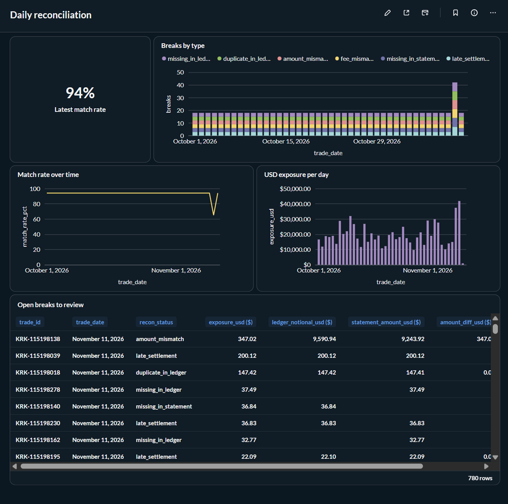
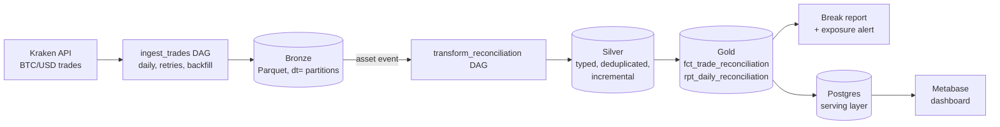

# Ledger Reconciliation Pipeline

An automated daily reconciliation between what happened on the exchange, what the platform booked in its ledger, and what the provider says settled. Every mismatch gets a cause and a USD exposure, so Accounting and Treasury start the day with a list of breaks instead of a spreadsheet.

Built as a small lakehouse: **Airflow 3** orchestration, **Parquet** landing zone, **dbt** in a bronze → silver → gold medallion, tests that prove the reconciliation catches every break, **Elementary** anomaly monitoring, a **Metabase** dashboard, **Terraform** for the AWS side, and **GitHub Actions** CI. It uses real BTC/USD trades from Kraken's public API as sample data, but the pattern applies to any ledger: payments, brokerage, marketplace payouts or revenue.



*Metabase dashboard. November 10 is a simulated bad day (fewer trades, 6% break rate per type), which Elementary flags as an anomaly; November 11 is a real day of Kraken trades.*

## The problem

Every trade exists in three places, and they should agree:

| Source | What it says | In production |
|---|---|---|
| Exchange | What actually executed | Exchange / broker API |
| Ledger | What we booked | Application Postgres |
| Provider statement | What settled | Custodian / bank / venue statements |

When they don't agree, someone has to find out why. This pipeline classifies every trade into one status:

| Status | Meaning |
|---|---|
| `matched` | All three agree (within a 2-cent rounding tolerance) |
| `missing_in_ledger` | Executed and settled, never booked |
| `duplicate_in_ledger` | Booked more than once |
| `missing_in_statement` | Booked, but the provider never reported it settled |
| `amount_mismatch` | Booked amount differs from the settled amount |
| `fee_mismatch` | Booked fee differs from the provider's fee |
| `late_settlement` | Settled later than T+1 |
| `missing_in_exchange` | Booked or settled with no matching execution |

## Architecture



- **Ingestion** (`ingestion/`): pulls one UTC day of trades and lands it as Hive-partitioned Parquet (`bronze/<dataset>/dt=YYYY-MM-DD/`). Each run replaces its partition, so retries and backfills are idempotent.
- **Ledger and statement are simulated** from the real trades, with about 1% of trades given a planted break of each type. Every planted break is recorded in a ground-truth table.
- **Orchestration** (`dags/`): `ingest_trades` runs daily with exponential-backoff retries. When it lands data it updates the `lake_bronze` asset, which triggers `transform_reconciliation` (asset-driven scheduling, no clock coupling).
- **Transformation** (`dbt/`): bronze views over the raw files, silver models that type and deduplicate (exchange trades are incremental, overwriting whole trade dates so re-runs never leave stale rows), and gold models with the reconciliation and daily KPIs.
- **Serving** (`serving/`): after each successful build, gold tables are copied to Postgres with an atomic table swap, so Metabase never sees a half-loaded table and never locks the DuckDB warehouse (which allows a single writer).

## Testing the reconciliation, not just the pipeline

`dbt build` runs 36 data tests plus 4 Elementary monitors (below). Beyond `unique` / `not_null` / `accepted_values`:

- **`assert_recon_finds_every_planted_break`**: compares the gold model against the simulator's ground truth. It fails if any planted break is missed, misclassified, or if a clean trade is flagged. It was mutation-tested: widening the tolerance to $100 makes it fail on the 42 missed breaks; setting it to $0 makes it fail on 1,045 false positives from provider rounding.
- **`assert_daily_report_reconciles_to_detail`**: the daily KPIs must add up to the trade-level detail.
- **`assert_trade_date_is_utc_execution_date`**: guards against timezone bugs in trade dates (one existed during development).

## Monitoring with Elementary

Tests catch what you know can go wrong; [Elementary](https://github.com/elementary-data/elementary) monitors catch what you didn't anticipate. They learn a 30-day baseline per daily bucket and warn (without blocking the pipeline) when today looks off:

| Monitor | Model | Catches |
|---|---|---|
| `volume_anomalies` | `slv_exchange_trades` | Days with far fewer or more trades than usual (a broken API page, a missed backfill), and missing recent days |
| `column_anomalies` (sum of `breaks`) | `rpt_daily_reconciliation` | A sudden jump in breaks, usually an upstream bug rather than bad luck |
| `column_anomalies` (sum of `exposure_usd`) | `rpt_daily_reconciliation` | Unusual USD at stake |
| `schema_changes` | `slv_ledger_entries` | Columns added, dropped or retyped in the ledger source |

To see them fire, simulate a bad day (fewer trades, more breaks) and rebuild:

```bash
python -m ingestion.run --date 2026-11-10 --source synthetic --max-trades 120 --break-rate 0.06
dbt build --project-dir dbt --profiles-dir dbt
# WARN volume_anomalies ... slv_exchange_trades
# WARN column_anomalies ... rpt_daily_reconciliation (breaks)
```

Results land in the `elementary` schema (`elementary_test_results`, `data_monitoring_metrics`), ready for alerting or the Elementary UI.

## Bugs this project caught in itself

- **Timezone drift**: daily buckets were computed in the machine's local time, shifting trades across days (and making Elementary flag a normal day as an anomaly). Fixed by pinning the DuckDB session to UTC; `assert_trade_date_is_utc_execution_date` guards it.
- **Zero-length intervals in Airflow 3**: plain `@daily` runs have no data interval, so a run would have ingested the current, incomplete day. Fixed with `CronDataIntervalTimetable`.
- **Stale rows on re-runs**: the incremental model upserted by `trade_id`, so re-running a day with fewer trades left the missing ones behind. Fixed by overwriting by `trade_date`; CI re-runs a day with fewer trades to prove it.

## Sample output

```
trade_date  trades  breaks  match_rate_pct  exposure_usd
2026-11-01     300      18           94.00     28,974.88
2026-11-02     300      18           94.00     18,968.57
2026-11-03     300      18           94.00     29,869.72
```

## Running it

**Without Airflow** (fastest, Python 3.11+):

```bash
pip install -r requirements.txt
./scripts/run_local.sh 2026-10-01 2026-11-07 synthetic   # or: kraken
# Elementary monitors need ~30 days of history to learn a baseline
```

**With Airflow 3** (Docker):

```bash
docker compose up --build        # Airflow: http://localhost:8080 · Metabase: http://localhost:3000
INGEST_SOURCE=synthetic docker compose up --build   # offline
```

Trigger `ingest_trades` from the UI; `transform_reconciliation` runs automatically when it finishes. To backfill a week:

```bash
docker compose exec airflow airflow backfill create --dag-id ingest_trades \
  --from-date 2026-11-02 --to-date 2026-11-08
```

## Dashboard

Metabase reads the gold tables from the Postgres serving layer: match rate over time, breaks by type, USD exposure per day, and the list of open breaks sorted by exposure. Setup and the five queries: [docs/metabase.md](docs/metabase.md).

## Infrastructure as code

[`infra/terraform`](infra/terraform) defines the production side: S3 lake with Glacier lifecycle for raw files, Glue databases per layer, an Athena workgroup with a cost guardrail, and a least-privilege pipeline role. CI runs `terraform fmt` and `terraform validate` on every push; `terraform output dbt_athena_profile` prints the dbt prod target.

## From local to production

The design maps one-to-one to an AWS lakehouse:

| Here | Production |
|---|---|
| Local Parquet (`data/lake/bronze/...`) | S3, same `dt=` layout |
| DuckDB `read_parquet` sources | Glue Data Catalog tables |
| dbt-duckdb | dbt-athena with `table_type: iceberg` (target stubbed in `dbt/profiles.yml`) |
| `airflow standalone` in Docker | Airflow on Kubernetes / Astronomer |
| Manual setup | `infra/terraform`: S3 + Glue + Athena + IAM |
| Simulated ledger | CDC from the app's Postgres (Airbyte / DMS) |
| Log warning on high exposure | Slack / PagerDuty alert to the Accounting on-call |
| Postgres serving copy for Metabase | Metabase querying gold Iceberg tables through Athena directly |

## Project structure

```
ingestion/   sources (Kraken, synthetic), simulator with planted breaks, lake writer
serving/     publishes gold tables to Postgres for Metabase
dags/        ingest_trades (daily, retries, backfill) · transform_reconciliation (asset-driven: dbt build → publish + report)
dbt/         bronze → silver → gold models, schema + singular tests
scripts/     run_local.sh
docs/        Metabase dashboard setup
infra/       Terraform for the AWS lakehouse (S3, Glue, Athena, IAM)
.github/     CI: ingest 5 weeks, dbt build, re-run a day with fewer trades; terraform fmt + validate
```
